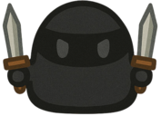

<div align="center">


# RPG Slime

**미로 속에서 슬라임이 몬스터를 사냥하고, 전직하고, 상대 팀을 사냥하는 실시간 멀티플레이어 RPG**

시작은 아무 능력도 없는 **슬라임 한 마리**.<br/>
몬스터를 잡아 레벨을 올리고, 전직 오브를 주워 **6종의 직업**으로 성장하세요.<br/>
맵 중앙 광장으로 갈수록 몬스터는 강해지고, 경험치는 7배가 됩니다.

`2인 개발` · `1주` · 카이스트 몰입캠프 4주차 프로젝트

[](https://phaser.io/)
[](https://socket.io/)
[](https://nodejs.org/)
[](https://vitejs.dev/)
[](https://railway.app/)
[](#-실행-방법)

[프로젝트 소개 페이지 (Notion)](https://countingbeats.notion.site/madcamp-project4-slime-rpg?source=copy_link)

</div>

---

## 🎬 플레이 영상

<div align="center">

<!--
  플레이 영상 자리입니다. 아래 중 한 가지 방식으로 교체하세요.

  1) YouTube 썸네일 링크 (FLYFRY와 동일한 방식)
     [](https://youtu.be/VIDEO_ID)
     ▶️ **[RPG Slime 플레이 영상 보기](https://youtu.be/VIDEO_ID)**

  2) GitHub에 직접 업로드한 mp4 (이슈/PR 작성창에 드래그해서 얻은 URL)
     https://github.com/user-attachments/assets/xxxxxxxx

  3) 저장소 내 GIF
     
-->

🚧 **플레이 영상 준비 중입니다.**





</div>

---

## 📖 목차

- [게임 소개](#-게임-소개)
- [실행 방법](#-실행-방법)
- [조작법](#-조작법)
- [게임 시스템](#-게임-시스템)
- [직업 & 스킬](#️-직업--스킬)
- [주요 구현](#-주요-구현)
- [아키텍처](#-아키텍처)
- [프로젝트 구조](#-프로젝트-구조)
- [배포](#️-배포)
- [기술 스택](#-기술-스택)
- [팀](#-팀)

---

## 🟢 게임 소개

RPG Slime은 **레드 / 블루 두 팀이 하나의 거대한 미로에서 성장 경쟁을 벌이는** 웹 기반 `.io` 스타일 RPG입니다.

모든 플레이어는 스킬 하나뿐인 기본 슬라임으로 시작합니다.
몬스터를 사냥해 레벨을 올리고, 몬스터가 떨어뜨리는 **전직 오브**를 주워 전사 · 어쌔신 · 마법사 · 궁수 · 서포터로 변신합니다.
맵은 중앙으로 갈수록 몬스터가 강해지는 4단계 구역으로 나뉘어 있어, **"어디까지 들어가서 사냥할 것인가"** 가 핵심 판단이 됩니다.

- 🗺️ **매번 새로 생성되는 미로** — 서버가 켜질 때마다 90×90 타일(9000×9000px) 미로를 새로 만듭니다.
- 🌑 **시야 제한** — 직업별 시야 범위 안에서만 적이 보이고, 벽 뒤는 그림자로 가려집니다.
- 🔮 **전직 오브** — 엘리트 몬스터는 100%, 일반 몬스터는 5% 확률로 드롭합니다.
- ⚔️ **PvP** — 상대 팀을 처치하면 `상대 레벨 × 100` 의 경험치를 얻습니다.
- 🛡️ **스폰 배리어** — 상대 팀 스폰 지역에 들어가면 1초마다 최대 체력의 10%가 깎입니다.
- 📡 **서버 권위 판정** — 데미지 · 쿨타임 · 버프 · 투사체 충돌을 모두 서버가 계산합니다.

---

## 🚀 실행 방법

### 요구 사항

- Node.js 18 이상
- npm

### 1. 설치

```bash
git clone https://github.com/mathison0/RPG_Slime.git
```

```bash
npm install
```

### 2. 개발 서버 실행

```bash
npm run dev
```

- 게임 서버(Express + Socket.IO): `http://localhost:80`
- 클라이언트(Vite): `http://localhost:5173`
- Vite가 `/socket.io` 요청을 게임 서버로 프록시합니다.

개별 실행이 필요하면 `npm run server:dev` (서버만) / `npm run client:dev` (클라이언트만) 를 사용하세요.

> ⚠️ 서버 기본 포트는 **80**입니다 (`GameConfig.SERVER.DEFAULT_PORT`).
> 환경에 따라 80번 포트 바인딩에 관리자 권한이 필요할 수 있습니다.
> 다른 포트를 쓰려면 `PORT` 환경변수를 지정하고 [`vite.config.js`](vite.config.js)의 프록시 target도 함께 맞춰 주세요.

### 3. 접속

브라우저에서 `http://localhost:5173` 접속 → 닉네임 입력 → `게임 시작`.
탭을 여러 개 열면 바로 멀티플레이어 테스트가 가능합니다. 팀은 인원이 적은 쪽으로 자동 배정됩니다.

### 4. 프로덕션 빌드

```bash
npm run build
```

```bash
npm start
```

`NODE_ENV=production` 이면 서버가 `dist/`를 정적 서빙하므로, 서버 하나만 띄우면 됩니다.

---

## 🎮 조작법

| 키 | 동작 |
| --- | --- |
| `W` `A` `S` `D` / 방향키 | 이동 |
| `마우스 좌클릭` | 기본 공격 (커서 방향) |
| `Space` | 점프 (전 직업 공통) |
| `Q` `E` `R` | 1 · 2 · 3번 스킬 |
| `M` | 전체 맵 토글 |
| `마우스 휠 클릭` | 핑 찍기 (1초 쿨다운, 팀 공유) |
| `Enter` / `Esc` | 전직 오브 획득 시 전직 확정 / 취소 |

### 디버그 치트

`Ctrl` + `Alt` + `C` 로 치트 모드를 켠 뒤에만 동작합니다.

| 키 | 동작 |
| --- | --- |
| `F` | 직업 선택 UI |
| `I` | 무적 토글 |
| `L` | 레벨업 |
| `T` | 디버그 모드 (히트박스 · 어그로 범위 표시) |
| `O` | 전체 맵 발견 처리 |
| `P` | 자살 (리스폰) |
| `Shift` (홀드) | 이동 속도 3배 |
| `1` `2` `3` `4` | 맵 네 꼭짓점으로 이동 |
| `0` | 광장 중앙으로 이동 |
| `K` | 몬스터 상태 콘솔 출력 |

---

## 🧩 게임 시스템

### 맵 구조

Prim 알고리즘으로 미로를 생성한 뒤 벽 일부를 무작위로 제거해 순환로와 공터를 만듭니다.
맵은 위치에 따라 4단계 구역으로 나뉘고, 구역마다 몬스터의 스탯 · 경험치 · 크기 배율이 다릅니다.

```
┌────────────────────────────────────────────────┐
│ 🔴 레드    │                     │    🔵 블루  │
│   스폰     │     Lv.2  미로      │     스폰    │
│  (6타일)   │   ┌─────────────┐   │   (6타일)   │
│            │   │    Lv.3     │   │             │
│  + 배리어  │   │  ┌───────┐  │   │   + 배리어  │
│  (4타일)   │   │  │ Lv.4  │  │   │   (4타일)   │
│            │   │  │ 광장  │  │   │             │
│            │   │  └───────┘  │   │             │
│            │   └─────────────┘   │             │
└────────────────────────────────────────────────┘
```

| 구역 | 스탯 배율 | 경험치 배율 | 크기 배율 | 최대 몬스터 |
| --- | --- | --- | --- | --- |
| Lv.1 스폰 배리어 (팀별) | ×0.5 | ×1.0 | ×0.7 | 각 30마리 |
| Lv.2 일반 미로 | ×1.0 | ×2.5 | ×1.0 | 250마리 |
| Lv.3 광장 외곽 (6타일) | ×1.7 | ×4.0 | ×1.5 | 60마리 |
| Lv.4 중앙 광장 (30×30타일) | ×2.3 | ×7.0 | ×2.0 | 50마리 |

- 상대 팀 스폰 배리어 구역에 들어가면 **1초마다 최대 체력의 10% 피해**를 입습니다.
- 플레이어와 몬스터가 **서로 다른 구역**에 있으면 공격이 무효 처리됩니다. (구역 밖 원거리 저격 방지)

### 몬스터

| 종류 | HP | 공격력 | 이동속도 | 인식 범위 | 경험치 |
| --- | --- | --- | --- | --- | --- |
| 🟦 Basic | 150 | 40 | 110 | 200 (최대 400) | 10 |
| 🟨 Charge | 70 | 70 | 160 | 350 (최대 550) | 15 |
| 🟥 Elite | 600 | 100 | 120 | 100 (최대 600) | 100 |

구역별 스폰 비율이 다릅니다. 중앙 광장은 Charge 60% / Elite 10%로 가장 위협적입니다.
위 표의 값에 구역 배율이 곱해지며, 공격 쿨타임은 공통 1.5초, 맵 전체 최대 동시 스폰 수는 420마리입니다.

### 성장

- **몬스터 처치** — 몬스터 기본 경험치 × 구역 경험치 배율
- **PvP 처치** — 처치당한 플레이어 레벨 × 100
- 레벨업 시 직업별 성장치만큼 HP · 공격력 · 이동속도가 오르고, 캐릭터 크기가 레벨당 2px씩 커집니다 (32px → 최대 64px).
- **체력 재생** — 피해를 받은 뒤 10초가 지나면 1초마다 최대 체력의 2%씩 회복
- **사망** — 3초 후 자기 팀 스폰 지역에서 부활

### 전직 오브

- 엘리트 몬스터는 **100%**, 일반 몬스터는 **5%** 확률로 전직 오브를 드롭합니다.
- 오브는 30초간 유지되며, 전사 / 어쌔신 / 마법사 / 궁수 / 서포터 중 랜덤한 직업이 배정됩니다.
- 오브에 닿으면 전직 확인 UI가 뜨고, `Enter`로 확정 / `Esc`로 취소합니다.

### 시야 & 와드

- 직업별 시야 범위(300~450) 안에서만 다른 플레이어와 몬스터가 보이며, 벽 뒤는 그림자로 가려집니다.
- 한 번 방문한 지역은 미니맵과 전체 맵(`M`)에 계속 기록됩니다.
- 서포터의 **와드**는 설치 지점 주변 시야를 팀 전체에 공유하고, 은신한 적을 드러냅니다.

---

## ⚔️ 직업 & 스킬

모든 스킬은 `Q` `E` `R`에 순서대로 대응하며, 쿨타임 · 데미지 · 효과는 전부 서버에서 검증됩니다.
데미지 표기의 `공격력`은 레벨에 따라 성장한 현재 공격력입니다.

###  슬라임 `slime` — 기본 직업

> HP 200 (+20/Lv) · 공격력 10 (+1/Lv) · 이동속도 200 · 시야 300 · 기본 공격 0.8초 (원거리, 사거리 250)

| 키 | 스킬 | 쿨타임 | 효과 |
| --- | --- | --- | --- |
| `Q` | **퍼지기** | 1초 | 주변 반경 150 범위 공격, 공격력 ×2.0 |

균형 잡힌 스탯의 시작 직업. 전직 전까지 안정적으로 몬스터를 사냥할 수 있습니다.

###  전사 `warrior` — 최전방 탱커

> HP 350 (+35/Lv) · 공격력 10 (+1/Lv) · 이동속도 180 · 시야 300 · 기본 공격 1.0초 (근접)

| 키 | 스킬 | 쿨타임 | 효과 |
| --- | --- | --- | --- |
| `Q` | **울부짖기** | 1초 | 주변을 위협하는 포효 (반경 50) |
| `E` | **휩쓸기** | 7초 | 부채꼴 범위(반경 150) 공격력 ×2.0, **2.5초 기절**. 선딜 0.5초 |
| `R` | **찌르기** | 10초 | 직선 범위(200×50) 공격력 ×7.0, **1.2초 기절**. 선딜 1.5초 |

압도적인 체력으로 버티며 기절로 상대를 묶는 정면 전투 특화 직업. 선딜이 길어 예측 사용이 중요합니다.

###  어쌔신 `assassin` — 암살자

> HP 100 (+10/Lv) · 공격력 10 (+1/Lv) · 이동속도 250 (+5/Lv) · 시야 450 · 기본 공격 0.25초 (근접)

| 키 | 스킬 | 쿨타임 | 효과 |
| --- | --- | --- | --- |
| `Q` | **은신** | 20초 | 3초간 투명화, 시야 +30% / 이동속도 +20%. 은신 중 첫 공격에 공격력 ×5.0 |
| `E` | **칼춤** | 30초 | 8초간 공격력 2배 |
| `R` | **목긋기** | 15초 | 사거리 350 내 적 뒤로 순간이동 후 공격력 ×3.0 |

가장 빠른 기본 공격 속도와 넓은 시야를 지녔지만 체력이 낮습니다. 은신 → 목긋기 → 칼춤 연계로 순식간에 적을 녹입니다.

###  마법사 `mage` — 범위 제어

> HP 130 (+13/Lv) · 공격력 5 (+1/Lv) · 이동속도 210 · 시야 360 · 기본 공격 0.7초 (원거리, 사거리 400)

| 키 | 스킬 | 쿨타임 | 효과 |
| --- | --- | --- | --- |
| `Q` | **얼음 장판** | 12초 | 시전 사거리 300, 반경 150에 3초간 슬로우 장판 |
| `E` | **마법 투사체** | 5초 | 커서 방향으로 발사, 명중 시 반경 90 폭발 + 공격력 ×5.0 |
| `R` | **보호막** | 20초 | 짧은 시간 동안 받는 피해를 무효화 |

기본 공격력은 가장 낮지만 스킬 계수가 높습니다. 얼음 장판으로 진입을 막고 투사체로 한 방을 노립니다.

###  궁수 `archer` — 지속 원거리 딜러

> HP 85 (+8/Lv) · 공격력 15 (+2/Lv) · 이동속도 160 · 시야 350 · 기본 공격 0.7초 (원거리, 사거리 600)

| 키 | 스킬 | 쿨타임 | 효과 |
| --- | --- | --- | --- |
| `Q` | **구르기** | 3초 | 바라보는 방향으로 150만큼 빠르게 회피 이동 |
| `E` | **궁사의 집중** | 25초 | 5초간 공격 속도 3배 |

가장 긴 사거리(600)와 가장 높은 공격력 성장치(+2/Lv)를 가진 대신 체력이 가장 낮습니다.
구르기로 거리를 유지하다가 집중으로 화력을 폭발시키는 플레이가 핵심입니다.

###  서포터 `supporter` — 팀 버퍼

> HP 150 (+15/Lv) · 공격력 30 (+3/Lv) · 이동속도 180 · 시야 320 · 기본 공격 1.3초 (근접)

| 키 | 스킬 | 쿨타임 | 효과 |
| --- | --- | --- | --- |
| `Q` | **와드 설치** | 10초 | 사거리 300에 설치, 200초간 반경 150 팀 시야 제공 + 은신 감지 |
| `E` | **버프 장판** | 10초 | 3초간 아군 이동속도 ×1.3 / 공격속도 ×2 |
| `R` | **힐 장판** | 10초 | 2.5초간 범위 내 아군을 공격력 ×0.4 만큼 지속 회복 |

세 스킬 모두 쿨타임이 10초로 짧습니다. 기본 공격력 성장치가 높아 힐량도 함께 성장합니다.

---

## 🔧 주요 구현

### 1. 서버 권위(Server-Authoritative) 전투 판정

멀티플레이어 게임에서 클라이언트가 데미지를 계산하면 그대로 치팅이 됩니다.
그래서 **전투와 관련된 모든 판정을 서버로 옮겼습니다.**

- 클라이언트는 `player-skill` 이벤트로 **"스킬을 쓰겠다"는 요청만** 보냅니다.
- 서버([`SkillManager`](server/src/managers/SkillManager.js))가 쿨타임 · 사거리 · 기절 상태 · 후딜레이를 검증하고,
  통과한 경우에만 데미지를 계산해 결과를 브로드캐스트합니다.
- 클라이언트는 돌아온 결과를 **연출만** 합니다. 이펙트·애니메이션과 실제 판정이 분리되어 있습니다.
- 데미지 계수는 `'attack * 2.0'` 같은 **문자열 수식**으로 정의해두고 서버에서 파싱합니다
  ([`JobClasses.js`](server/shared/JobClasses.js)). 밸런스 패치 시 설정 파일 한 줄만 고치면 됩니다.

### 2. 스킬 상태 머신과 투사체 동기화

스킬마다 **선딜(`delay`) → 발동 → 후딜(`afterDelay`)** 구간이 있고, 그 사이 기절 · 은신 · 구르기 같은
상태가 겹쳐 들어옵니다. 이 구간들이 클라이언트와 서버에서 어긋나면 "분명 스킬을 썼는데 안 나가는" 문제가 생깁니다.

- 플레이어는 `isCasting` · `isInAfterDelay` · `isStunned` · `isRolling` 상태를 가지며,
  각 상태에서 **이동 / 기본 공격 / 스킬 사용 가능 여부**가 개별적으로 결정됩니다 ([`Player.js`](src/entities/Player.js)).
- 서버도 [`ServerPlayer`](server/src/entities/ServerPlayer.js)에 동일한 상태와 `delayedActions` 타이머를 유지해,
  선딜 중 사망하거나 기절당하면 예약된 액션을 전부 취소합니다.
- 장판형 스킬(얼음 장판 · 버프 장판 · 힐 장판)은 시전 후에도 서버 틱마다 범위 내 대상을 재평가하며,
  시전자는 장판 유지 중에도 다른 스킬을 쓸 수 있습니다.

**투사체**는 클라이언트가 마우스 좌표만 보내고, 서버가 `atan2`로 방향 벡터를 만들어 직접 굴립니다
([`ProjectileManager`](server/src/managers/ProjectileManager.js)).
서버 틱마다 위치를 적분하며 벽 AABB 충돌과 대상 피격을 판정하고, 최대 사거리를 넘으면 소멸시킵니다.
클라이언트는 같은 궤적을 렌더링만 하므로 **맞았는지 여부는 항상 서버가 결정**합니다.

### 3. 이동은 클라이언트, 위치는 서버 동기화

전투와 달리 **이동은 반응성이 생명**이라 클라이언트에서 즉시 처리합니다.

- 본인 캐릭터는 입력 즉시 움직이고, 위치가 **바뀐 경우에만** 서버로 전송해 트래픽을 줄입니다.
- 다른 플레이어는 서버에서 받은 좌표를 향해 **트윈으로 보간**해 끊김 없이 렌더링합니다.
- 서버 게임 루프는 **50ms(20Hz)** 주기로 몬스터 AI · 투사체 · 체력 재생 · 스폰 배리어 피해를 처리합니다.

### 4. 시야 시스템 (Fog of War)

두 장의 `RenderTexture`를 겹쳐 시야를 구현했습니다 ([`VisionManager`](src/managers/VisionManager.js)).

- **1단계** — 화면 전체를 덮는 검은 텍스처에서, 플레이어 시야 범위만큼을 원형으로 `erase` 합니다.
- **2단계** — 시야 범위 안에서도 벽에 가려지는 영역을 계산해 그림자를 덧그립니다.
- 아군 **와드**의 시야 범위도 같은 방식으로 뚫어주며, 적 팀 와드 근처에서는 은신이 해제됩니다.
- 한 번 밝혀진 타일은 `discovered` 배열에 기록되어 미니맵과 전체 맵(`M`)에 남습니다.

### 5. 절대 시간 기반 타이머

스킬 선딜 · 후딜 · 버프 만료 등 타이밍에 민감한 처리가 많은데,
각각을 `setTimeout`이나 개별 `requestAnimationFrame`으로 돌리면 탭이 비활성화될 때 어긋납니다.

[`AbsoluteTimerManager`](src/managers/AbsoluteTimerManager.js)는 **단 하나의 루프**로 모든 예약 이벤트를 관리하며,
상대 시간이 아닌 `Date.now()` 기준 **절대 시간**으로 목표 시각을 저장해 탭 전환 후에도 동기화가 유지됩니다.

---

## 🌐 아키텍처

```
  ┌─────────────────┐                    ┌──────────────────────────────┐
  │   Client (A)    │  ── player-update  │        Game Server           │
  │                 │  ── player-skill ► │   Express + Socket.IO        │
  │  Phaser 3       │                    │                              │
  │  · 입력 / 렌더링 │  ◄ game-state ──── │  ┌────────────────────────┐  │
  │  · 이동 예측     │  ◄ skill-result ── │  │ GameStateManager       │  │
  │  · 시야 / 미니맵 │  ◄ enemy-update ── │  │  데미지 · 경험치 · 팀   │  │
  └─────────────────┘                    │  ├────────────────────────┤  │
                                         │  │ SkillManager           │  │
  ┌─────────────────┐                    │  │  쿨타임 · 검증 · 장판   │  │
  │   Client (B)    │  ◄──────────────►  │  ├────────────────────────┤  │
  │        ⋮        │                    │  │ EnemyManager           │  │
  └─────────────────┘                    │  │  스폰 · AI · 리스폰     │  │
                                         │  ├────────────────────────┤  │
  ┌─────────────────┐                    │  │ ProjectileManager      │  │
  │   Client (N)    │  ◄──────────────►  │  │  투사체 물리 · 충돌     │  │
  └─────────────────┘                    │  └────────────────────────┘  │
                                         │      게임 루프 50ms (20Hz)    │
                                         └──────────────────────────────┘
```

- **단일 권위 서버** — 별도 DB 없이 모든 게임 상태를 서버 메모리에 두고, 50ms 주기로 브로드캐스트합니다.
- **Socket.IO** — WebSocket을 우선 사용하고 실패 시 polling으로 폴백합니다. 클라이언트의 [`NetworkManager`](src/utils/NetworkManager.js)는 싱글톤으로 소켓 중복 생성을 막습니다.
- **설정 단일화** — 직업 · 몬스터 밸런스 수치는 전부 `server/shared/`에 모여 있습니다.
- **정적 서빙** — `NODE_ENV=production`이면 같은 Express 서버가 빌드된 클라이언트(`dist/`)까지 서빙하므로 단일 프로세스로 배포됩니다.

---

## 📁 프로젝트 구조

```
RPG_Slime/
├── index.html                    # HUD(레벨/HP/직업/경험치/핑) + 랭킹 오버레이
├── vite.config.js                # 개발 프록시 & 빌드 설정
├── railway.json / Procfile       # 배포 설정
│
├── public/assets/                # 직업·몬스터 스프라이트 (4방향), 스킬 이펙트
│
├── src/                          # 🖥 클라이언트 (Phaser 3)
│   ├── main.js                   # Phaser 게임 인스턴스 (1200×800, Arcade Physics)
│   ├── scenes/
│   │   ├── LoadingScene.js       # 에셋 로딩 & 프로시저럴 스프라이트 생성
│   │   ├── MenuScene.js          # 닉네임 입력 / 랜덤 닉네임
│   │   └── GameScene.js          # 메인 게임 루프, 전직 UI, 랭킹, 리스폰
│   ├── entities/
│   │   ├── Player.js             # 이동 · 입력 · 버프 · 체력바 · 애니메이션
│   │   ├── Enemy.js              # 몬스터 렌더링 / 보간
│   │   ├── JobOrb.js             # 전직 오브
│   │   └── jobs/                 # 직업별 클라이언트 연출 (6종)
│   ├── managers/
│   │   ├── NetworkEventManager.js  # 서버 이벤트 → 게임 오브젝트 반영
│   │   ├── MapManager.js           # 벽 · 타일 · 스폰 구역 렌더링
│   │   ├── VisionManager.js        # 시야 마스크, 벽 그림자, 와드 시야
│   │   ├── MinimapManager.js       # 미니맵 / 전체 맵(M)
│   │   ├── ProjectileManager.js    # 투사체 렌더링
│   │   ├── PingManager.js          # 핑 마커 & 미니맵 방향 화살표
│   │   ├── AbsoluteTimerManager.js # 단일 rAF 루프 기반 절대시간 타이머
│   │   └── CheatManager.js         # 디버그 치트
│   ├── effects/EffectManager.js  # 스킬 이펙트
│   ├── ui/                       # 체력바, 스킬 쿨다운 UI
│   └── utils/                    # NetworkManager(싱글톤 소켓), AssetLoader
│
└── server/                       # 🗄 서버 (Node.js)
    ├── index.js                  # Express + Socket.IO 부트스트랩, 게임 루프(50ms)
    ├── generateMap.js            # Prim 알고리즘 미로 생성 + 광장 생성
    ├── shared/
    │   ├── JobClasses.js         # 직업 스탯 · 스킬 정의 (단일 진실 공급원)
    │   └── MonsterConfig.js      # 몬스터 스탯 · 구역별 배율 · 스폰 비율
    └── src/
        ├── config/GameConfig.js  # 맵 크기, 체력 재생, 스폰 배리어 등 전역 상수
        ├── entities/
        │   ├── ServerPlayer.js   # 권위 상태(HP / 경험치 / 버프 / 쿨타임)
        │   ├── ServerEnemy.js    # 몬스터 AI (배회 / 어그로 / 추격)
        │   └── jobs/             # 직업별 서버 로직 (6종)
        └── managers/
            ├── GameStateManager.js   # 데미지 · 힐 · 경험치 · 전직 오브 · 팀 밸런싱
            ├── SocketEventManager.js # 소켓 이벤트 핸들러
            ├── SkillManager.js       # 스킬 시전 · 검증 · 장판/버프 처리
            ├── EnemyManager.js       # 몬스터 스폰 · 리스폰 관리
            └── ProjectileManager.js  # 투사체 물리 & 충돌 판정
```

---

## ☁️ 배포

### Railway

1. Railway에서 GitHub 저장소 연결 → `New Project` → `Deploy from GitHub repo`
2. [`railway.json`](railway.json)의 NIXPACKS 설정으로 자동 빌드 / 배포됩니다.

### Render

1. `New Web Service` 선택 후 저장소 연결
2. Build Command: `npm run build`
3. Start Command: `npm start`

### 환경 변수

| 변수 | 설명 | 기본값 |
| --- | --- | --- |
| `PORT` | 서버 포트 | `80` |
| `NODE_ENV` | `production`이면 `dist/`를 정적 서빙 | — |

---

## 🧰 기술 스택

| 분류 | 사용 기술 |
| --- | --- |
| 게임 엔진 | Phaser 3.70 (Arcade Physics) |
| 클라이언트 | JavaScript (ES Modules), Vite 5 |
| 서버 | Node.js, Express 4 |
| 네트워킹 | Socket.IO 4.7 (WebSocket 우선 / polling 폴백) |
| 상태 관리 | 서버 인메모리 (DB 미사용) |
| 배포 | Railway (NIXPACKS), Render / Heroku 호환 |
| 아트 | 직업 6종 · 몬스터 3종 4방향 스프라이트 및 스킬 이펙트 자체 제작 |

---

## 👥 팀

| | 역할 | GitHub |
| --- | --- | --- |
| **석인호** <br/> 카이스트 전산학부 23학번 | **게임 월드 & 인프라 코어**<br/>절차적 미로 맵 생성, 몬스터 AI·스폰 스케줄러, Fog of War 시야 및 미니맵, 데미지/경험치/팀 밸런싱을 담당하는 권위 상태 관리, Socket.IO 이벤트 계층 및 매니저 아키텍처 설계 | [@easter1000](https://github.com/easter1000) |
| **박세영** <br/> 한양대학교 컴퓨터소프트웨어학부 23학번 | **전투 시스템 & 클라-서버 동기화**<br/>6개 직업 15종 스킬 설계 및 구현, 투사체 시스템(방향 벡터 발사 · 서버 충돌 판정), 선딜/후딜·기절·버프 등 스킬 상태 머신 동기화, 장판형 지속 효과, 스킬 쿨다운 UI, 팀 핑 시스템, 와드 기반 팀 시야 공유, 전체 게임 에셋 제작 | [@mathison0](https://github.com/mathison0) |

---

<div align="center">


**광장까지 살아서 도달해 보세요** 🟢

</div>
